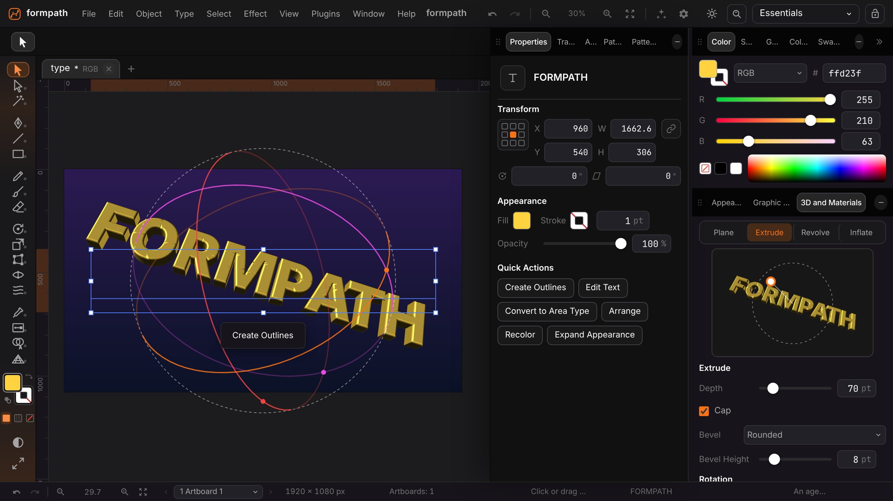
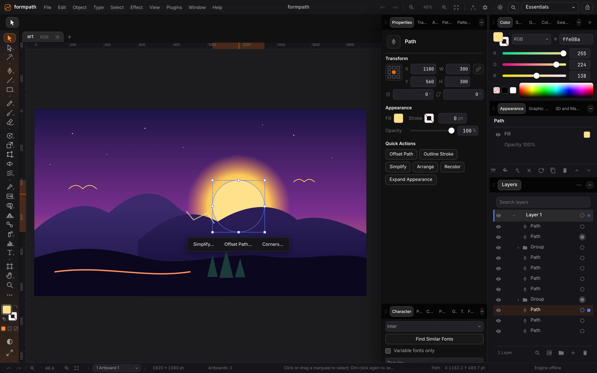
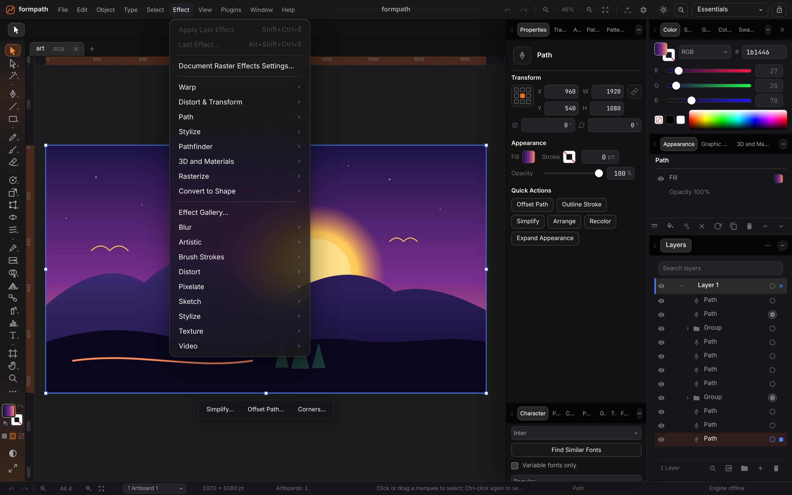
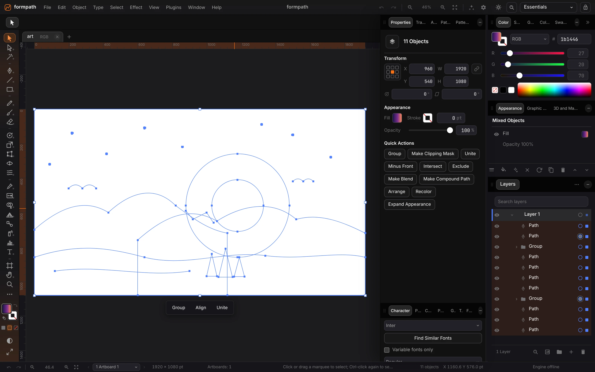

<p align="center">
  
</p>

<h1 align="center">FormPath</h1>

<p align="center">
  <b>Vector illustration; artboards, pen tools and live effects in one window.</b><br>
  Pen and Curvature tools, Pathfinder, gradients, live effects and 3D type,<br>
  with SVG, PDF, EPS and DXF. Local-first, no account, and agents can draw in it.
</p>

<p align="center">
  
  
  
  
  
  
</p>

<p align="center">
  <a href="https://formpath.formai.studio/"><b>Download FormPath on formai.studio</b></a> ·
  <a href="#run-it-from-source">Run it from source</a>
</p>

<br>

<p align="center">
  
  <br>
  <sub>Live 3D extrude on editable type, with the Properties, Color and 3D and Materials panels open.</sub>
</p>

<p align="center">
  <a href="#features">Features</a> ·
  <a href="#everything-in-the-box">In the box</a> ·
  <a href="#built-for-agents">Agents</a> ·
  <a href="#under-the-hood">Under the hood</a> ·
  <a href="#download">Download</a> ·
  <a href="#run-it-from-source">Run from source</a>
</p>

<br>

<table>
  <tr>
    <td width="25%" valign="top"><h3>Live everything</h3>Shapes, corners, effects, Trace Image and 3D stay editable after you draw them.</td>
    <td width="25%" valign="top"><h3>Real file formats</h3>Opens and writes SVG, PDF, EPS and DXF, and opens any PDF or PDF-compatible <code>.ai</code> as editable art.</td>
    <td width="25%" valign="top"><h3>Local-first</h3>Projects save as <code>.fpth</code> on your computer, with a library, conflict copies and crash recovery. No account.</td>
    <td width="25%" valign="top"><h3>Agent-ready</h3>The same commands from the window, the terminal and an MCP server for Claude Code, Codex and Cursor.</td>
  </tr>
</table>

<br>

## Features

<table>
  <tr>
    <td width="50%" valign="top">
      
      <br><sub>A selected shape with its Properties, Color, Appearance and Layers panels.</sub>
      <h3>Panels that follow the selection</h3>
      Transform, fill, stroke and opacity sit next to quick actions such as Offset Path and Outline Stroke. Every object keeps its own appearance stack.
    </td>
    <td width="50%" valign="top">
      
      <br><sub>The Effect menu over a full artboard.</sub>
      <h3>Live effects</h3>
      Warps, Pathfinder, 3D and Materials and the Effect Gallery apply as live effects. Change or remove them later without redrawing.
    </td>
  </tr>
  <tr>
    <td width="50%" valign="top">
      
      <br><sub>Outline view with all eleven objects selected.</sub>
      <h3>Paths you can reach</h3>
      Outline view shows every anchor and curve. With several objects selected, Unite, Minus Front, Intersect, Exclude and Make Compound Path are one click away.
    </td>
    <td width="50%" valign="top">
      <h3>Type that stays type</h3>
      Point, area, vertical and on-path type with OpenType features, variable fonts, Glyphs and Create Outlines through real glyph outlines.
    </td>
  </tr>
</table>

## Everything in the box

<table>
  <tr>
    <td width="33%" valign="top">
      <h4>Drawing and layout</h4>
      Artboards · Layers and sublayers · Pen · Curvature · Pencil · Paintbrush · Blob Brush · Live shapes · Knife · Smart guides · Rulers and grids</td>
    <td width="33%" valign="top"><h4>Paint, effects and type</h4>Gradients · Gradient mesh · Patterns · Recolor Art · Pathfinder · Blends · Symbols · Envelopes · Trace Image · 3D Extrude, Revolve, Inflate, Plane · Effect Gallery · Variable fonts</td>
    <td width="33%" valign="top"><h4>Formats</h4>Opens: <code>.fpth</code>, SVG, PDF, <code>.ai</code>, EPS, DXF, PNG, JPEG, WebP · Saves: <code>.fpth</code>, SVG, PDF, EPS, DXF, PNG, JPEG, WebP · Native: <code>.fpth</code></td>
  </tr>
</table>

Interface in 26 languages, chosen in Preferences, Interface. What is covered and what is still partial, row by row: [`docs/PARITY.md`](docs/PARITY.md).

## Built for agents

The window, the terminal and the MCP server run the same command catalogue; the MCP server lists 93 tools.

```sh
./formpath cli list                  # list the command catalogue from a terminal
./formpath cli describe <command>    # show one command and its arguments
./formpath claude                    # Claude Code with FormPath's tools attached
./formpath mcp                       # MCP server on stdio for Claude Code, Codex and Cursor
```

`.mcp.json`, `.codex/config.toml` and `.cursor/mcp.json` are already wired in this repo. `./formpath agents install` sets them up for your user account. See [`AGENTS.md`](AGENTS.md).

## Under the hood

- **Engine:** a document engine in TypeScript with no DOM, rendered by the stage and driven by tools registered in one registry.
- **Service:** a FastAPI engine for projects, fonts, file import and export, and the MCP endpoint at `/mcp`.
- **Desktop:** a Tauri 2 shell that starts the engine as a sidecar.
- **UI:** keyed DOM patching and a pre-paint theme boot, so changes do not flash or re-render.
- **Tested:** Vitest suites for `.fpth`, SVG, PDF, Pathfinder and type outlines, plus pytest suites for the engine guard, consent, MCP, versions and project files.

## Download

| Platform | Download | Release |
|---|---|---|
| macOS | [Download FormPath for macOS](https://formai.studio/get/formpath/macos) | [FormPath releases on FormCompiler](https://github.com/nodemode-dev/formcompiler/releases?q=formpath-v&expanded=true) |
| Windows | [Download FormPath for Windows](https://formai.studio/get/formpath/windows) | [FormPath releases on FormCompiler](https://github.com/nodemode-dev/formcompiler/releases?q=formpath-v&expanded=true) |
| Linux | [Download FormPath for Linux](https://formai.studio/get/formpath/linux) | [FormPath releases on FormCompiler](https://github.com/nodemode-dev/formcompiler/releases?q=formpath-v&expanded=true) |

All FormPath builds are compiled and released from [FormCompiler](https://github.com/nodemode-dev/formcompiler); this repo holds the source.

## Run it from source

Prefer it in your browser, or want to contribute? Run the web UI straight from this repo.

**Requires:** Node 20.19 or newer (22 recommended), Python 3.12 or newer, git. The desktop window also needs Rust stable and the Tauri 2 system packages.

```sh
git clone git@github.com:nodemode-dev/formpath.git
cd formpath
./formpath install    # installs the engine service and the frontend
./formpath boot       # engine and web UI, UI at http://localhost:5230
```

`./formpath desktop dev` opens the desktop window instead, and `./build_app` builds and installs it.
On Windows use `formpath.bat install` and `formpath.bat boot`. The engine listens on `127.0.0.1:8230` (API under `/api`, MCP at `/mcp`) and reads `backend/.env`, never committed (`backend/.env.example` is the template). Settings are `FORMPATH_HOST`, `FORMPATH_PORT`, `FORMPATH_DATA_DIR`, `FORMPATH_CORS_ORIGINS`, `FORMPATH_DIST` and `FORMPATH_TARGET`.

> [!IMPORTANT]
> **Status:** pre-release. The macOS and Windows desktop bundles, signing and the updater are not verified yet, and some parity rows are partial, listed in [`docs/PARITY.md`](docs/PARITY.md). PDF import skips encrypted files, `.ai` files saved without PDF compatibility and some scanned images, and reports what it left out.

**Contributing:** branch from `main`, keep changes to source here, and leave packaging and releases to FormCompiler. See [`.docs/BRANCHING.md`](.docs/BRANCHING.md) and [`AGENTS.md`](AGENTS.md).

## Repository

`frontend/` (Vite, vanilla TypeScript) · `backend/` (FastAPI engine) · `src-tauri/` (desktop shell) · `setup/` (one script per task) · `docs/` (manual and parity)

Docs: [`.docs/wiki`](.docs/wiki) · Agents: [`CLAUDE.md`](CLAUDE.md), [`AGENTS.md`](AGENTS.md) · Contributing: [`.docs/BRANCHING.md`](.docs/BRANCHING.md)

---

## Maintainers

| Maintainer | Role |
|---|---|
| [@nodemode-ai](https://github.com/nodemode-ai) | Owner |
| [@gbarnai](https://github.com/gbarnai) | Co-owner |

Code owners are set in [`.github/CODEOWNERS`](.github/CODEOWNERS).

## License

FormPath is licensed under the Apache License 2.0 ([`LICENSE`](LICENSE), SPDX `Apache-2.0`). Copyright 2026 NodeAgentc, Inc. Third-party notices: [`NOTICE.md`](NOTICE.md).

<sub>Adobe and Illustrator are either registered trademarks or trademarks of Adobe in the United States and/or other countries. FormPath is not affiliated with or endorsed by Adobe. The names are used only to describe file compatibility (`.ai`, `.eps`).</sub>
